# Mitu: an AI assistant for shops that sell in DMs on Facebook, Instagram and WhatsApp

Small sellers on Facebook, Instagram and WhatsApp have no website or checkout: every sale happens in DMs, and most messages are "price?", "is M available?", "delivery charge outside Dhaka?" and "COD?". Mitu answers them in chat, day and night. It answers product questions (prices, sizes and colours, what's left in stock, delivery charges), takes orders for delivery or pickup with cash on delivery or bKash (for today or a later day), counts stock down so the last one is never sold twice, understands voice notes and photos (a screenshot of a post: "how much is this one?"), and hands off to a person when it should. The demo business is **Nakshi Threads**, a clothing shop in Dhaka, set up in `business.yaml`.

One install runs many businesses, each with its own products, settings, staff, chats, orders and WhatsApp/Messenger/Instagram accounts. The same code also runs a café (orders for today, required options, allergens): see `examples/cafe.yaml` and [What a business does](#what-a-business-does).

- **Dashboard** (home page; staff sign in with their business's ID and their own password):
  - **Overview:** revenue per day, orders, cancellations, top items, pickup vs delivery, AI-handled share and AI cost, each compared with the previous period.
  - **Packing** (Kitchen for the café): live orders in New / Preparing / Ready columns, with a sound when one arrives and a button to pause online orders.
  - **Orders:** every order, with a CSV export.
  - **Conversations:** live chats with staff replies (with saved replies from `business.yaml`) and an AI on/off switch per chat. Under each customer message, "AI used …" shows the tools the AI called, what they returned and what that turn cost.
  - **Products** (Menu for the café): prices, options, stock, dietary info, photos, and a sold-out switch.
- **Chat simulator** (`#/simulator`, signed-in staff only, since every message runs the paid LLM): a WhatsApp-style phone in the browser, with a hold-to-record mic and a photo button.
- **Real chats:** WhatsApp through the Cloud API webhook; Messenger and Instagram through the Messenger Platform webhook; SMS and phone calls through Twilio, so customers on any mobile phone (no app, no data) can text or call.

Every channel runs the same code path: `pipeline.py` → `agent.respond()` → LLM with tools. [How it works](#how-it-works) has the architecture and data-flow diagrams and a breakdown of each component.

```
business.yaml          the demo shop: hours, delivery, payments, fixed messages, products (each business on the install has its own)
examples/cafe.yaml     another kind of business: a café that takes orders for today (the tests and the eval use it)
backend/
  app/config.py        .env, money helpers
  app/tenancy.py       which business a request or message belongs to; every query on a business's data is filtered to it
  app/auth.py          staff passwords (scrypt) and login sessions
  app/shops.py         creating businesses from business.yaml files
  app/db.py            SQLAlchemy models (SQLite by default)
  app/hours.py         opening hours in the business's timezone
  app/options.py       menu options ("Milk: Full cream, Oat +0.80") and checking a customer's choices
  app/tools.py         the AI's tools: search_menu, get_menu, get_item, send_item_photo, saved_details, create_order,
                       get_order_status, cancel_order, get_business_info, escalate_to_human
  app/llm.py           LLM interface: the Anthropic API or Ollama (LLM_PROVIDER)
  app/agent.py         system prompt, history, tool loop, handoff
  app/pipeline.py      one entry point per message type (text / voice / photo / other), used by every channel
  app/whatsapp.py      WhatsApp webhook (verify, signature, dedupe) + Graph API client
  app/messenger.py     Messenger and Instagram webhook + Send API
  app/twilio.py        SMS and phone calls (Twilio): webhooks, signature check, sending SMS, the call's spoken turns
  app/voice.py         speech-to-text (OpenAI gpt-4o-transcribe or Whisper), ffmpeg helpers
  app/main.py          FastAPI: dashboard + simulator API
  manage.py            add businesses and staff, connect their WhatsApp number and Facebook Page
  seed.py  cli.py  eval.py  backup.py  tests/  evals/
frontend/              React + Vite + Tailwind (dashboard + simulator), served by Caddy in Docker
```

## 1. Run locally

You need Python 3.12+, Node 20+ and **ffmpeg** on your PATH (ffmpeg is only needed for voice notes).

```bash
cp .env.example .env           # then fill in at least the LLM credentials, SHOP_ID and ADMIN_PASSWORD

# backend
cd backend
python -m venv .venv
.venv/bin/pip install -r requirements.txt        # Windows: .venv\Scripts\pip
.venv/bin/python seed.py                         # creates the first business (SHOP_ID) from business.yaml and .env,
                                                 # with a few sample orders
                                                 # (add --demo for 60 days of fake ones to fill the Overview)
.venv/bin/python cli.py 0412345678               # optional: chat with the first business's agent in the terminal
.venv/bin/uvicorn app.main:app --reload --port 8000

# frontend (second terminal)
cd frontend
npm install
npm run dev                                      # http://localhost:5173
```

Open http://localhost:5173 and sign in with the business ID (`SHOP_ID`, e.g. `nakshi`) and `ADMIN_PASSWORD`. `seed.py` refuses passwords under 8 characters or like `admin` and `change-me`. The simulator is at `#/simulator` once you're signed in, and talks to your business.

**Coming from an older version** (from before one install ran several businesses)? Its database doesn't fit, and the server will say so. Move `backend/shop.db` (and `backend/media/`) aside, or point `DATABASE_URL` at a new file, then run `seed.py`.

Run the tests (no credentials needed, the LLM and Graph API are mocked, and the business's clock is pinned to 10:00). They include checks that one business can never see or change another's data, through any page or webhook:

```bash
cd backend && .venv/bin/python -m pytest
```

The tests use a fake LLM, so they can't tell you whether the real model behaves. The eval does: 39 scripted customer conversations in `backend/evals/cases.yaml`, mostly on the café in `examples/cafe.yaml`, plus the shop (menu questions, allergies, ordering, required options, closing time, cancelling, refunds and complaints going to the team, prompt injection, …) run against the real model from `.env`. Each runs on a throwaway database at 10:00 café time, checking which tools were called, what ended up in the database, and the replies. Run it after changing the prompt, the tools, the menu format or the model. It costs roughly $1–3 per full run on Sonnet (about double on Opus, free on Ollama):

```bash
cd backend && .venv/bin/python eval.py              # all cases; exit code 1 if any fail
.venv/bin/python eval.py cancel shop                # only cases whose name contains a word
```

Models vary from run to run, so a single failure is worth reading (the transcript is printed) before you change anything. Add a case whenever a real chat goes wrong.

**Docker:** `cp .env.example .env`, fill it in, then `docker compose up --build` and open http://localhost (port 80 already taken? `HTTP_PORT=8080 docker compose up --build` and open http://localhost:8080). Rebuild with `--build` after pulling new code: plain `docker compose up` runs the old images. The first start creates the first business from `.env` and `business.yaml`. Caddy serves the app and passes `/api`, `/media` and the webhooks to the backend, which has no public port. Seed data loads on first start, and the database and media live in the `data` volume. A `backup` container writes a `.tar.gz` of the database and media to `./backups` at start and then daily, keeping 14.

### LLM settings

- `LLM_PROVIDER=ollama` (default) runs a local model through [Ollama](https://ollama.com), with no cloud account: `ollama pull qwen3:4b`, or set `OLLAMA_MODEL` to another one. It needs a model with tool support (and a vision model, like `qwen2.5vl`, for customer photos). Good for trying the flow for free; expect more mistakes and slow replies on a CPU.
- `LLM_PROVIDER=anthropic` uses the Anthropic API with `ANTHROPIC_API_KEY`. It runs at `LLM_EFFORT=low` for snappy chat replies, prompt caching is on, and server-side refusal fallbacks are on (`fallbacks: "default"`), so a false-positive safety decline is retried on another model instead of failing.

## 2. Connect real WhatsApp (Meta test number + ngrok)

1. Go to https://developers.facebook.com → **My Apps → Create app**. Choose **Other → Business**, give it a name and create it.
2. In the app dashboard, find **WhatsApp** and click **Set up**. Pick or create a Meta Business account when asked.
3. Open **WhatsApp → API Setup**. Meta gives you a **test phone number** and a **temporary access token** (valid 24 hours).
   - Copy the token into `WHATSAPP_TOKEN`.
   - Copy the **Phone number ID** (not the phone number itself) into `WHATSAPP_PHONE_NUMBER_ID`.
   - Under **To**, add your own WhatsApp number and confirm the code Meta sends. The test number can only message up to 5 verified numbers.
4. Go to **App settings → Basic**, click **Show** next to **App secret**, and copy it into `WHATSAPP_APP_SECRET`. The webhook rejects any request without a valid `X-Hub-Signature-256`.
5. Set `WHATSAPP_VERIFY_TOKEN` in `.env` to any random string you choose, then restart the backend.
6. Expose the backend: `ngrok http 8000`. Copy the `https://….ngrok-free.app` URL.
7. In **WhatsApp → Configuration → Webhook**, click **Edit**:
   - Callback URL: `https://<your-ngrok-url>/webhook`
   - Verify token: the same value as `WHATSAPP_VERIFY_TOKEN`
   - Click **Verify and save**. Meta calls `GET /webhook` and the backend echoes the challenge.
8. Still under Webhook fields, **Subscribe** to `messages`.
9. Send a WhatsApp message from your verified number to the test number. The reply comes from Mitu, and the chat appears in the dashboard.

`seed.py` copies `WHATSAPP_TOKEN` and `WHATSAPP_PHONE_NUMBER_ID` (and `PAGE_ACCESS_TOKEN`, `PAGE_ID`, `INSTAGRAM_ID`) into the first business when it creates it. To change them after that, use `python manage.py connect <business ID> --whatsapp-token ...`; editing `.env` won't change an existing business.

For anything beyond a demo, create a **System User** in Business Settings and generate a permanent token instead of the 24-hour one. A real business number also needs Meta business verification.

## 3. Set up a business

Each business is described by a file like `business.yaml` (the first business uses `BUSINESS_FILE`, default `business.yaml`):

- **The basics:** name, the assistant's name, `timezone`, `currency`, location (add parking and transport, since people ask), about.
- **`hours`:** per day, e.g. `"07:00-15:00"` or `"07:00-11:00, 17:00-21:00"`; leave a day out to close it. Orders are only accepted inside these. `prep_minutes` is the earliest an order can be ready, and `quote_reminder_minutes` is when a customer who hasn't answered an order summary gets one nudge.
- **`fulfilment`:** pickup and delivery, with fees and notes. `needs_address: true` makes the assistant ask for an address.
- **`payment_methods`:** with only one, the assistant never asks.
- **`allergen_note`, the fixed replies, and the messages customers get** when staff move an order on.
- **`saved_replies`:** quick replies staff can insert in the chat box.
- **`menu`:** each item has an `id`, `name`, `category`, `price`, `description`, `options`, `dietary`, `allergens`, `aliases` (other names customers use) and optionally `available: false`. Options are one line per group: `"Size*: Regular, Large +0.80"` (`*` = must pick one), `"Milk: Full cream, Oat +0.80"` (at most one), `"Extras (any): Extra shot +0.60"` (any number). The dashboard's Menu page uses the same format.

For the first business, run `python seed.py`. After that, manage the menu on the Menu page; re-running `seed.py` (or `manage.py update-shop`) only adds items that aren't in the database yet.

## 4. Run several businesses on one install

Every business gets its own menu, settings, staff, chats, orders and AI-cost figures. Staff sign in with their business's ID and their own password and only ever see their business. The LLM and speech keys in `.env` are shared, and the Overview page shows what each business's AI costs, which is what you'd bill on.

```bash
cd backend
.venv/bin/python manage.py add-shop harbour-bistro harbour.yaml --owner-password 'a-long-password'
.venv/bin/python manage.py add-staff harbour-bistro Sam 'sams-password'
.venv/bin/python manage.py connect harbour-bistro --whatsapp-number-id 1234567890 --whatsapp-token EAAG... \
                                                  --page-id 9876543210 --instagram-id 1784... --page-token EAAG...
.venv/bin/python manage.py update-shop harbour-bistro harbour.yaml   # after editing its settings file
.venv/bin/python manage.py list
```

All businesses share one Meta app (`WHATSAPP_APP_SECRET`, `WHATSAPP_VERIFY_TOKEN`) and the same webhook URLs. Each WhatsApp message is routed to the business whose number it was sent to (`phone_number_id`), and each Messenger or Instagram message to the business whose Page or account received it. With a single business on the install, everything goes to it, so the ids are optional. To put your customers' own numbers on your Meta app, Meta requires you to join its Tech Provider program and use Embedded Signup; until then, each business can use a number on your own Meta business account.

### What a business does

What a business does follows from the sections in its settings file, and the assistant, its tools and the dashboard's pages follow from that:

| Section | Turns on |
|---|---|
| `fulfilment` + `payment_methods` | orders (pickup, delivery zones, any payment methods, e.g. cash on delivery and bKash) and the Packing (or Kitchen) and Orders pages |
| `allergen_note` | the allergy rules in the prompt |

On items, `stock: 12` makes the assistant count them down (it never sells more than are left, and a cancelled order puts them back), and `orders_days_ahead: 7` lets customers order for a later day. `kind: an online clothing shop` is how the assistant describes the business. `labels` renames dashboard pages (the café sets `kitchen: Kitchen` and `menu: Menu`; a shop's are Packing and Products), and `try_messages` are the examples the chat simulator offers. `business.yaml` is a working shop; `examples/cafe.yaml` is a café.

```bash
.venv/bin/python manage.py add-shop little-fern ../examples/cafe.yaml --owner-password 'a-long-password'
```

### A public demo for the website

The marketing site can let visitors chat with one business, typed or by voice note, without signing in: `POST /api/demo/message`, `POST /api/demo/voice` and `GET /api/demo/{visitor}/messages`, where `visitor` is a random ID the browser keeps. It's off until `DEMO_SHOP` is set. Because strangers are spending your LLM money, each browser and each IP gets `DEMO_MESSAGES_PER_VISITOR` messages (default 20) and everyone together gets `DEMO_MESSAGES_PER_DAY` (default 300); after that the demo answers 429. The demo business never emails anyone, so a visitor asking for a person doesn't reach your inbox. Its chats, orders and bookings show in its own dashboard like any other business's.

```bash
.venv/bin/python manage.py add-shop demo ../examples/demo-sydney.yaml --owner-password 'a-long-password'
# then in .env: DEMO_SHOP=demo and DEMO_ORIGINS=https://your-website.example
```

`examples/demo-sydney.yaml` is the shop from `business.yaml` in Sydney and Australian dollars, with no `stock` counts so visitors can't sell it out.

## 5. CI/CD and deploying

`.github/workflows/ci-cd.yml` runs on every push and pull request:

1. **Backend lint and tests** (`ruff check .`, then `pytest`, fake LLM and mocked Meta API, so no secrets needed) and **frontend build**.
2. On `main` only: builds the backend and frontend Docker images and pushes them to GitHub Container Registry
   (`ghcr.io/<owner>/<repo>-backend` / `-frontend`, tagged `latest` and the commit SHA).
3. Deploys them over SSH with `docker compose pull && up -d`, once these repository secrets exist
   (Settings → Secrets and variables → Actions):

| Secret | What |
|---|---|
| `ENV_FILE` | The whole production `.env` (API keys, the first business's `SHOP_ID`, `ADMIN_PASSWORD`, `STAFF` and tokens, `PUBLIC_URL`, `SITE_ADDRESS`) |
| `DEPLOY_HOST` | Server address; without it the deploy step is skipped |
| `DEPLOY_USER` | SSH user that can run `docker` |
| `DEPLOY_SSH_KEY` | That user's private key |

Update the production settings with `gh secret set ENV_FILE < .env.production` and re-run the workflow.
On the server, set `SITE_ADDRESS` in `ENV_FILE` to your domain and point the domain's DNS at the server with ports 80 and 443 open: Caddy gets and renews the HTTPS certificate itself. Your webhook URLs are then `https://<domain>/webhook` and `https://<domain>/messenger/webhook`.

Add more businesses on the server with `docker compose exec backend python manage.py ...` (their business files can sit in the `data` volume).

Backups land in `~/mituai/backups` on the server. **Copy them off the server** (e.g. a nightly `rclone copy` or `aws s3 sync` from cron): a backup on the same disk doesn't survive losing the server. To restore, stop the stack, put `shop.db` and `media/` from an archive back into the `data` volume, and start it again.

## Voice notes

The flow: WhatsApp `audio` message → `GET /{media_id}` → download with the token → save the original (for the dashboard player) → ffmpeg to 16 kHz mono WAV → reject anything over 2 minutes → speech-to-text → if the transcript is empty or confidence is below `STT_MIN_CONFIDENCE`, reply "please repeat or type it" (never guess) → otherwise the same `agent.respond()` as typed text. The transcript is stored marked as a voice note, and each step's time is logged.

Speech-to-text is OpenAI `gpt-4o-transcribe` (`OPENAI_API_KEY`; `OPENAI_STT_MODEL=whisper-1` for the older model), prompted with the menu's item names so it spells them right. Confidence is the average probability of the transcript's words (Whisper: of its segments). Replies are always text.

**Languages.** The assistant replies in the language the customer writes or speaks in; there's nothing to switch on. The speech model detects the language of a voice note itself. `gpt-4o-transcribe` is the default because it's much better than `whisper-1` outside the biggest languages, Bangla included (Whisper is weak on Bangla, Punjabi, Gujarati, Telugu, Sinhala, Burmese and Khmer). When nearly all of a business's customers speak one language, set `voice_language` in its business file to its ISO code (`bn` for Bangla, `hi`, `ms`, `tl`, …): the model then doesn't have to guess. Check a new language on real recordings before promising it, and tune `STT_MIN_CONFIDENCE` if good notes get a "please repeat". The fixed messages in the business file (handoff, "couldn't catch that voice note", order updates) are sent as written, so they're in whatever language you wrote them in.

## Decisions

Simplest options picked where the brief was open:

- **Order confirmation is enforced in code, not just the prompt.** `create_order(confirmed=false)` checks everything and quotes, and stores the quote on the chat. `confirmed=true` only works if that quote was made in an *earlier* turn, so the customer must have sent a message after seeing the summary. Whether that message means "yes" is the LLM's call. Confirming checks everything again (sold out since? kitchen closed? orders paused?), and if the price changed it shows the new total and asks again.
- **The demo is a shop that sells in DMs, not a café.** Cafés mostly take orders through delivery apps, so chat is a side channel for them; for Facebook and Instagram sellers the chat is the whole shop. The café stays as `examples/cafe.yaml`, and the tests and eval still run on it.
- **Orders are for today only** by default, for "as soon as possible" (now plus `prep_minutes`) or a time today inside opening hours. A shop that ships sets `orders_days_ahead`; the time must still be inside its hours that day. There's no capacity per day: add one when a business gets more orders than it can make.
- **Orders only, for now.** Table bookings, salon appointments and an approvals queue were built and then taken out to keep the demo small; they're in git history (the commit that removed them says so) for when a business needs them. A refund, discount or other exception goes to a person through the handoff, so the assistant never promises or refuses one itself.
- **One reminder** per unanswered order summary, checked every minute by the backend and sent only inside the messaging window. It's marked before sending, so a failed send never becomes a second nudge.
- **Sold out is a switch; stock counts are optional.** Cafés run out of things during the day and nobody counts croissants into a system, so items without `stock` just have the switch. A shop sets `stock`: placing an order counts it down with a conditional update (two customers can't both buy the last one), and cancelling, by the customer or on the dashboard, puts it back.
- **Allergens:** the assistant only repeats the tags on each item plus the business's allergen note, never says a dish is safe, and hands serious allergy questions to a person.
- **Time:** each customer message in the history starts with its local send time (`[Sat 12 Oct 2026 13:05]`), so "tomorrow" and "in 20 minutes" work. It's part of the stored message, so the cached prompt prefix doesn't change from turn to turn.
- **Money** is stored in cents and shown with `currency` from `business.yaml`.
- **History is text only**, except the customer's own photos (JPG/PNG), which are re-sent as images every turn (prompt caching makes the repeats cheap). Each turn's tool calls stay inside that turn, and the model re-looks things up next turn. The last 30 messages are sent.
- **Every business's data is filtered in one place.** Business tables share a `Scoped` base. A SQLAlchemy hook adds `shop_id = <business in scope>` to every SELECT, UPDATE and DELETE on them, new rows get it automatically, and a query with no business in scope raises instead of returning everything. One forgotten filter can't leak another business's orders. Dashboard requests get their business from the login session, webhooks from the number or Page they were sent to, and background jobs loop over businesses.
- **Customers can only see and change their own orders,** the ones placed in the same chat. Nothing is looked up by a phone number someone types.
- **Handoff** sets `needs_human` and switches the AI off for that chat. Turning it back on in the dashboard clears the flag. If the LLM call fails, the customer gets a polite fixed message and the chat is flagged.
- **Fixed replies** (unsupported media, unclear or too-long voice note, errors) skip the LLM and come from `business.yaml`.
- **`% handled by AI`** counts the period's chats that were never flagged and got no staff reply.
- **"Today"** uses `timezone` from `business.yaml`.
- **Live updates** use polling (1–5 s), not websockets. The kitchen sound plays when the page is open and its polling sees a new order (browsers pause polling in background tabs, so keep the kitchen screen in front).
- **Dashboard auth:** each person has their own password (scrypt-hashed) at their business, and signing in returns a session token, valid for 30 days, that the dashboard sends with every request. Only the token's SHA-256 is stored. 10 wrong passwords from one IP lock that IP out for 15 minutes; it's per IP, so a guesser can't lock the owner out. The lockout is in memory and resets on restart. Each business's Meta tokens are stored in the database as plain text; encrypt them at rest if the database ever leaves the server. Media files under `/media` are public but have random 128-bit names.
- **The simulator** runs in background tasks like WhatsApp and the page polls, so it exercises the exact same path. Simulator chat IDs are `sim-<phone>`.
- **Menu search** is a fuzzy scan in Python over names, categories and aliases, which is fine for a menu.

## How it works

This section is for developers: how a message travels through Mitu, what each part of the backend owns, and where to change what. Diagrams are [Mermaid](https://mermaid.js.org), which GitHub draws inline. File names link to the code; read the code before changing behaviour, and the **Decisions** above before redoing one.

Three ideas hold the whole app together:

1. **One path for every message.** WhatsApp, Messenger, Instagram, the simulator and `cli.py` all end up in `agent.respond()`. Fix shared behaviour there, never per channel.
2. **One business at a time.** Every query runs with exactly one business in scope, and the database layer refuses to run one without it.
3. **The rules live in code, the conversation in the prompt.** The LLM decides what the customer means; the tools decide what's allowed (prices, stock, opening hours, order confirmation).

### The system at a glance

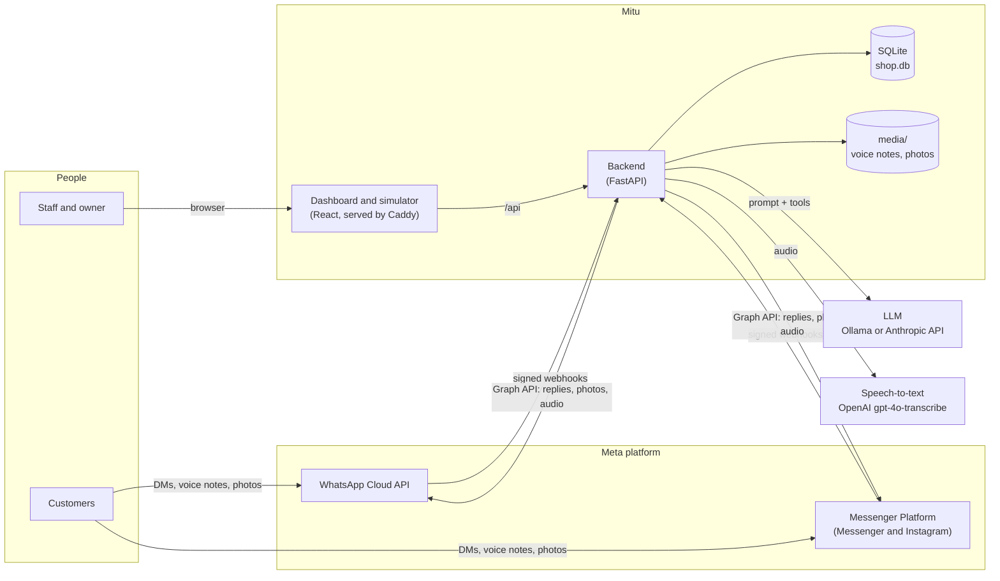

Customers never see Mitu's own address: they write to the business's WhatsApp number, Facebook Page or Instagram account, and Meta forwards each message to Mitu's webhooks. Staff use the dashboard. Everything else (the LLM and speech-to-text) is called by the backend on the way through.

### How it's deployed

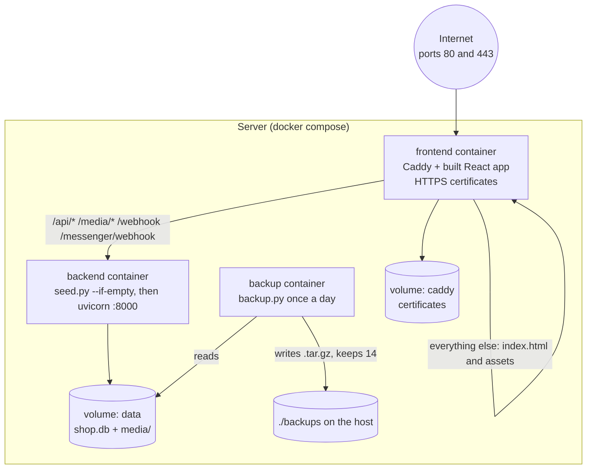

The backend has no published port: only Caddy reaches it, which is also why uvicorn trusts the forwarded client IP (`--proxy-headers`, used by the login lockout). `business.yaml` is mounted read-only into the backend for the first start. See [`docker-compose.yml`](docker-compose.yml), [`frontend/Caddyfile`](frontend/Caddyfile) and [`backend/Dockerfile`](backend/Dockerfile).

### Processes and threads

Everything runs in **one uvicorn process**. Inside it:

| What | Where | Why it's separate |
|---|---|---|
| HTTP requests (dashboard API, webhooks) | uvicorn workers | Webhooks must answer Meta fast, so they only store the message and queue it |
| Handling a message (LLM, tools, reply) | FastAPI `BackgroundTasks` | An LLM turn takes seconds; Meta retries if the webhook is slow |
| Re-running messages a restart cut off | `pipeline.resume_unfinished`, a thread started once at startup | So a crash mid-reply doesn't lose a customer's message |
| The every-minute job (unanswered-quote reminders) | `main.every_minute`, a daemon thread | Loops over every business, each in its own scope |

One lock keeps concurrent work safe: `agent._locks` runs one agent turn at a time per chat (customers send bursts of messages). It assumes one process; the `ponytail:` comment next to it says what to change for several workers. Stock is safe without it: it's counted down with a conditional update.

### Which business a request belongs to

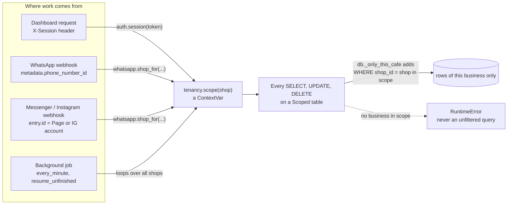

The scope is a `ContextVar` in [`tenancy.py`](backend/app/tenancy.py), so it follows the request or job and can't leak between threads. New rows get `shop_id` filled in automatically. With a single business on the install, `shop_for` sends every webhook to it, so the channel ids are optional.

### Trust boundaries

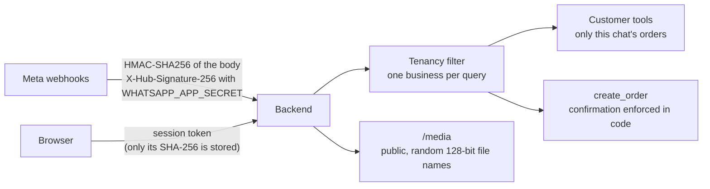

| Boundary | Guard | Code |
|---|---|---|
| Meta → backend | Signature check on every POST; `GET /webhook` only echoes the challenge for the right verify token | [`whatsapp.py`](backend/app/whatsapp.py) `valid_signature`, `verify` |
| Browser → backend | scrypt passwords, 30-day session tokens stored hashed, 10 wrong passwords per IP lock it for 15 minutes | [`auth.py`](backend/app/auth.py), `main.login` |
| One business → another | `Scoped` tables filtered by the business in scope | [`db.py`](backend/app/db.py), [`tenancy.py`](backend/app/tenancy.py) |
| Customer → other customers | Tools look up orders by this chat only, never by a typed phone number | `tools._own`, `tools.saved_details` |
| LLM → the shop's data | Tools validate everything; the order needs a quote in an earlier turn | `tools.create_order` |
| Internet → backend | Only Caddy is reachable; the backend has no public port | [`docker-compose.yml`](docker-compose.yml) |

Known gaps are written down where they live: Meta tokens are stored as plain text in the `shops` table, and the login lockout is in memory.

### A WhatsApp message, end to end

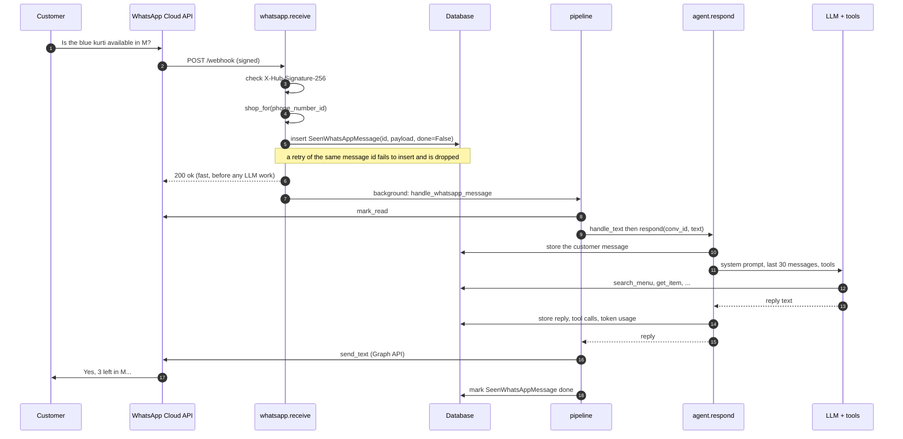

The conversation id is `<business>:<phone>`, so the same customer writing to two businesses on one install has two separate chats.

### Messenger and Instagram

They take the same path as WhatsApp from `pipeline` onwards; only the edges differ ([`messenger.py`](backend/app/messenger.py), `pipeline.handle_meta_event`):

| | WhatsApp | Messenger / Instagram |
|---|---|---|
| Webhook | `POST /webhook` | `POST /messenger/webhook` (`object`: `page` or `instagram`) |
| Signed with | the Meta app secret | the same app secret |
| Which business | `phone_number_id` | the entry id: `page_id` or `instagram_id` |
| Who the customer is | their phone number | a page-scoped id (PSID/IGSID); Mitu asks for a phone when ordering |
| Conversation id | `<business>:<phone>` | `<business>:messenger-<id>` or `<business>:instagram-<id>` |
| Skipped | status updates | read receipts, deliveries and echoes of our own replies |
| Sending a photo | upload, then send with a caption | Meta fetches it from `PUBLIC_URL`; photo first, then the text |

### SMS and phone calls

One Twilio account for the install (`TWILIO_ACCOUNT_SID`, `TWILIO_AUTH_TOKEN`); each business gets its own Twilio number (`manage.py connect <id> --twilio-number +61...`, or `TWILIO_NUMBER` for the first business). On the number's settings in the Twilio console, point **A message comes in** at `https://<PUBLIC_URL>/twilio/sms` and **A call comes in** at `https://<PUBLIC_URL>/twilio/voice` (both HTTP POST). `PUBLIC_URL` must be the address Twilio calls, since it's part of the signature every webhook is checked against ([`twilio.py`](backend/app/twilio.py)).

- **Texts and calls from one number share a chat** (`<business>:phone-<number>`), so a caller who's sent an order summary can reply "yes" by SMS. Anything Mitu or staff send later (status updates, reminders, staff replies) goes by SMS, with no 24-hour window. Photos go as a link, since MMS only works in the US and Canada.
- **A call is a chat turn per sentence.** Twilio turns the caller's speech into text (`<Gather input="speech">`) and posts it to `/twilio/voice/turn`; `agent.respond()` runs as for any message, with one extra line in the prompt for calls (short spoken sentences, no lists); Twilio reads the reply aloud (`<Say>`) and listens again. The greeting is stored as the first assistant message. Silence, a handoff, or a chat staff have taken over ends the call, and staff call or text back.
- **Business settings:** `call_language` (default `en-US`, for both what callers speak and the voice, e.g. `bn-IN`; check Twilio's speech-recognition and text-to-speech language lists), `call_voice` (optional, e.g. `Google.en-US-Neural2-F`), and `call_greeting` / `call_goodbye` under `messages`.
- **Limit:** Twilio waits 15 seconds for each turn, so a slow model (or Ollama on a CPU) ends the call with Twilio's error message. Twilio doesn't sell Bangladeshi numbers; a shop in Bangladesh needs a number from another country, or a local SMS gateway (not built).

### Duplicate webhooks and crash recovery

Meta retries a webhook it thinks failed, and a restart can cut a reply off halfway. Both are handled by one table, `seen_wa_messages`:

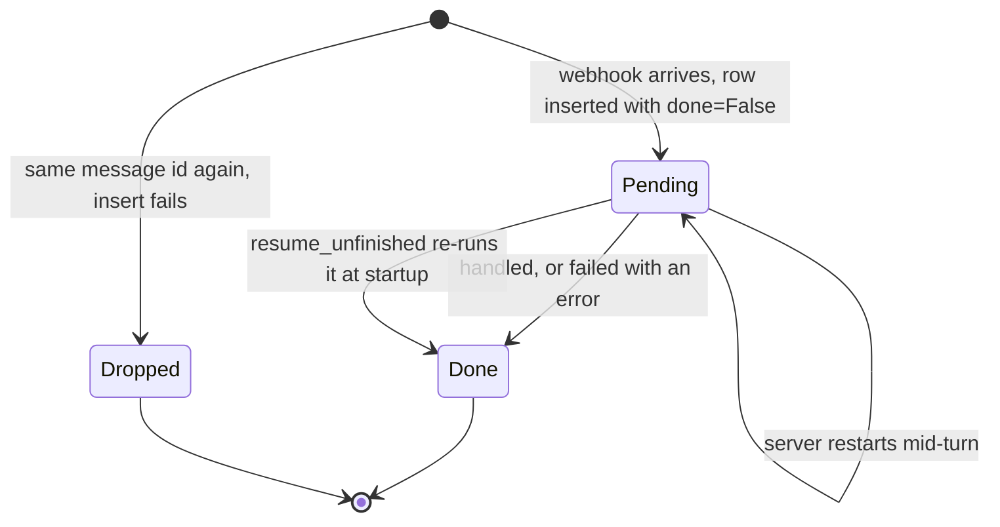

The primary key is Meta's message id, so a retry can't be inserted twice. An error still marks the message done (no retry loop); only a crash leaves it pending. That makes delivery at-least-once: rarely, a customer whose reply was cut off by a restart gets it twice.

### One agent turn

`agent.respond()` in [`agent.py`](backend/app/agent.py) is the single entry point every channel uses:

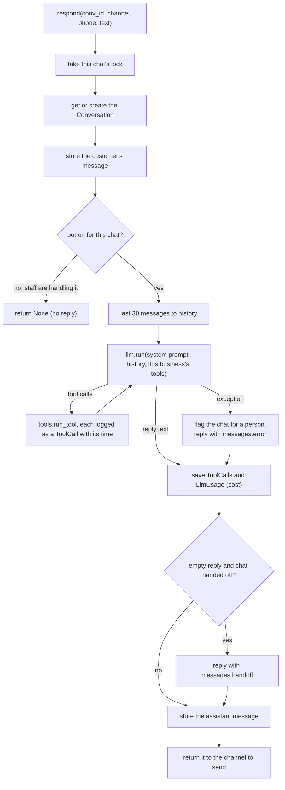

The tool calls and usage are saved even when the LLM fails halfway, so the dashboard's "AI used …" line and the cost figures stay true.

### The tool loop

Each provider in [`llm.py`](backend/app/llm.py) runs the same loop in its own native format, which keeps the model's thinking and tool blocks intact between steps:

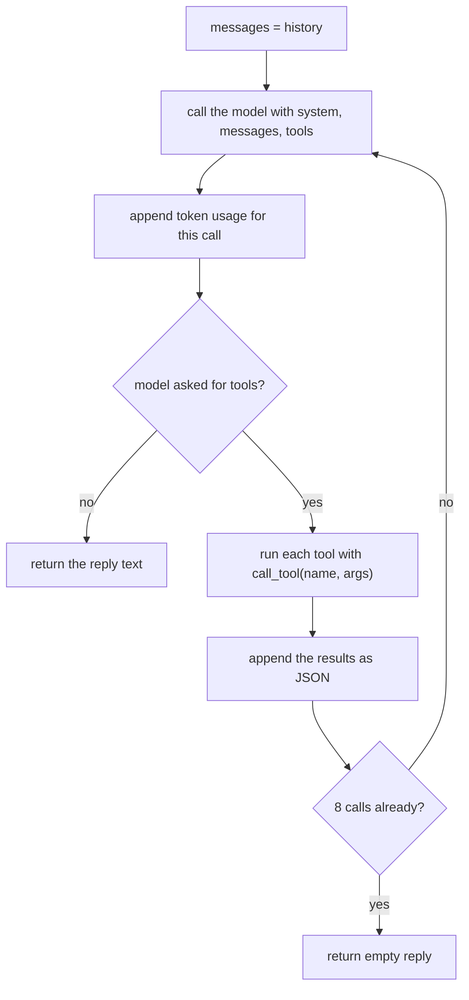

An empty reply is never sent as-is: `agent.respond` turns it into the handoff message if the chat was handed off, and sends nothing otherwise. On the Anthropic API a refusal also returns empty, after the server-side fallback has already retried it on another model.

### The prompt and tools are built per business

Nothing about a business is hard-coded: the prompt and the tool list are assembled on every turn from its settings file.

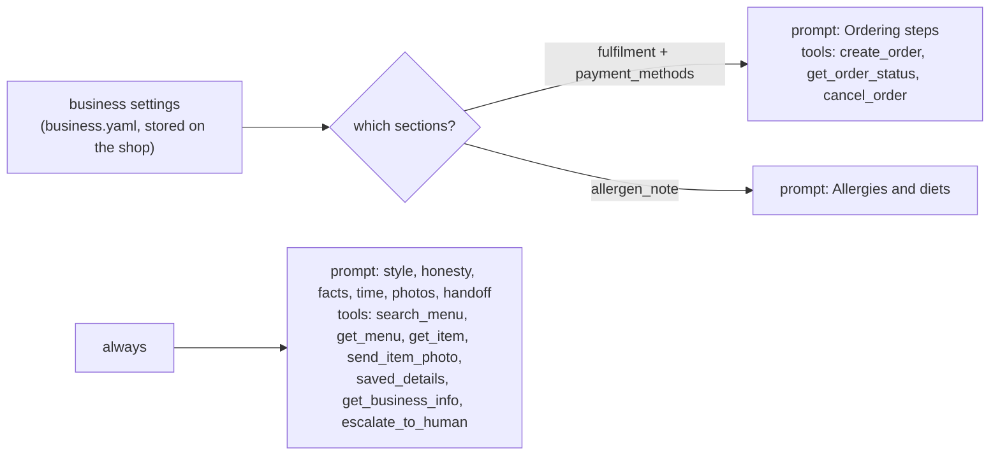

`tools.enabled()` decides which tools exist, `tools.specs()` builds their JSON schemas (the `fulfilment` and `payment_method` enums come from the business's own choices), and `agent.system_prompt()` adds only the sections that apply. A business without `fulfilment` is never told about ordering, and couldn't call `create_order` if it tried: `run_tool` rejects tools that aren't enabled.

### What the LLM sees as history

`agent.build_history()` turns stored messages into the history sent on every turn:

- **The last 30 messages**, oldest first, starting with a customer message.
- **Staff replies count as the business** (role `assistant`), so the model knows what a person already told the customer.
- **Each customer message starts with its local send time**, like `[Sat 12 Oct 2026 13:05]`, so "tomorrow" and "in 20 minutes" work. It's part of the stored text, so the cached prompt prefix doesn't change between turns.
- **Markers** say what a message was: `[voice note]` (the transcript), `[photo]` (the customer's photo, re-sent as an image each turn), `[photo sent]` (a product photo we sent, kept as text).
- **Consecutive messages from one side are merged**, since the LLM APIs want turns to alternate.
- **Tool calls aren't kept between turns.** The model looks things up again, so it never quotes yesterday's stock or price.

### Placing an order: two steps, enforced in code

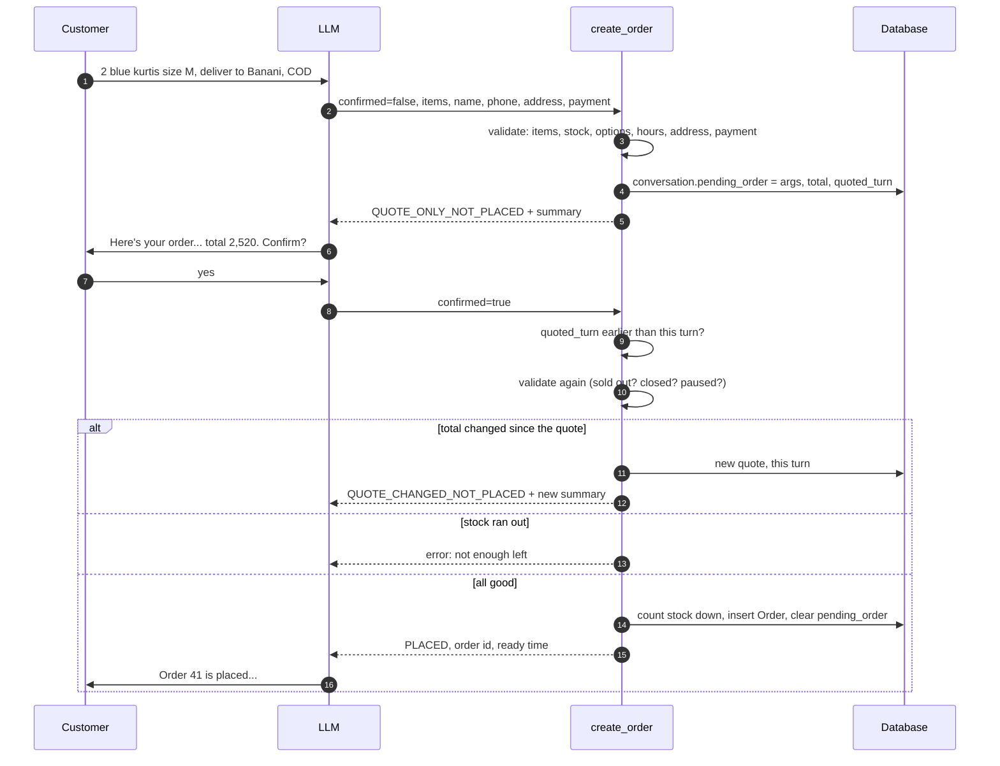

The guard is `quoted_turn < turn_id`: a quote made in the same turn can't be confirmed, so the model can't quote and place in one breath. The customer must send a message after seeing the summary. Whether that message means yes is the model's call; everything else is checked in code.

### The pending quote's lifecycle

A chat holds at most one quote, in `conversations.pending_order`:

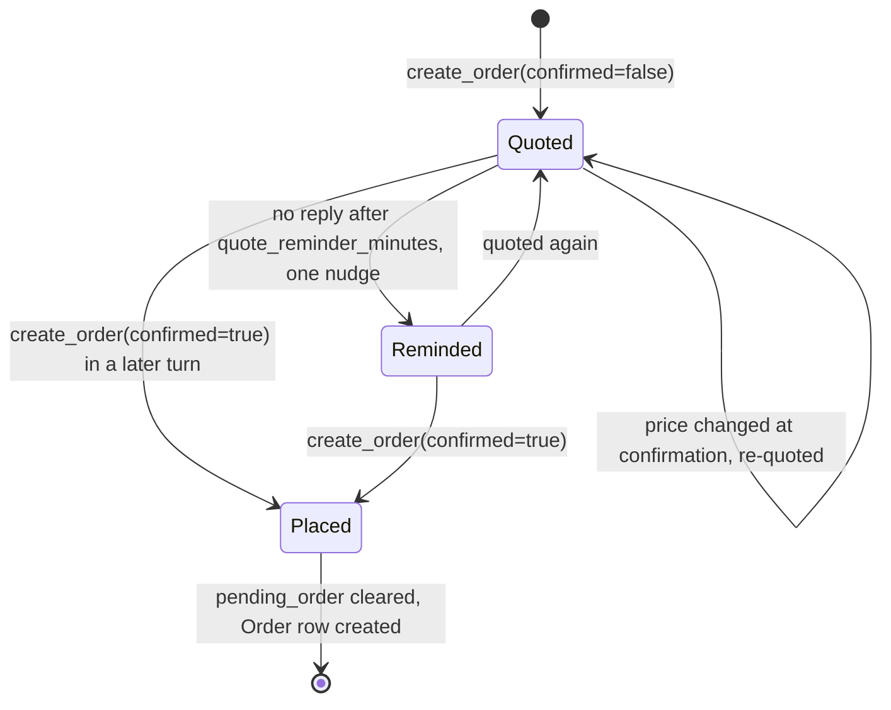

The stored quote keeps the arguments, the total, the turn it was made in and when, plus `reminded`. Confirming re-runs the validation on the stored arguments, not on anything the model passes in.

### Stock

Items work two ways: `available` is a sold-out switch, and `stock` (optional) is a count.

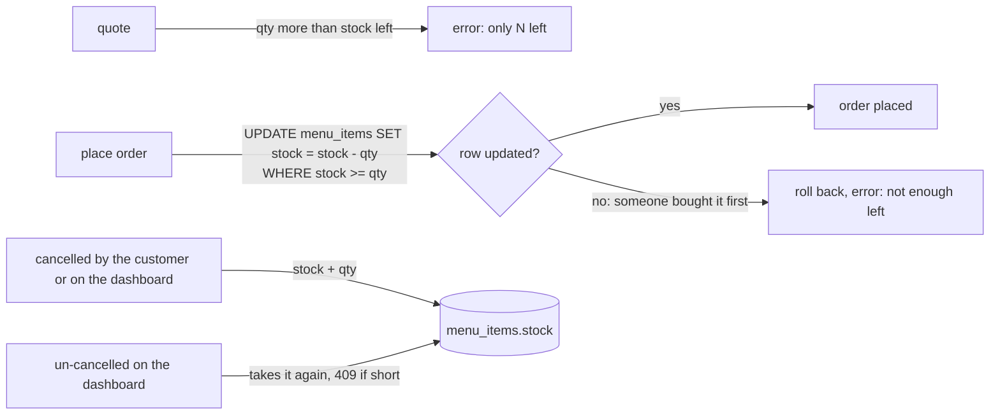

The count goes down with one conditional `UPDATE`, so two customers can't both buy the last one even when their turns run at the same moment. An item with stock 0 counts as sold out (`tools.in_stock`). Items without a count are skipped. Counting per size or colour isn't built yet (issue #1).

### Order status and customer updates

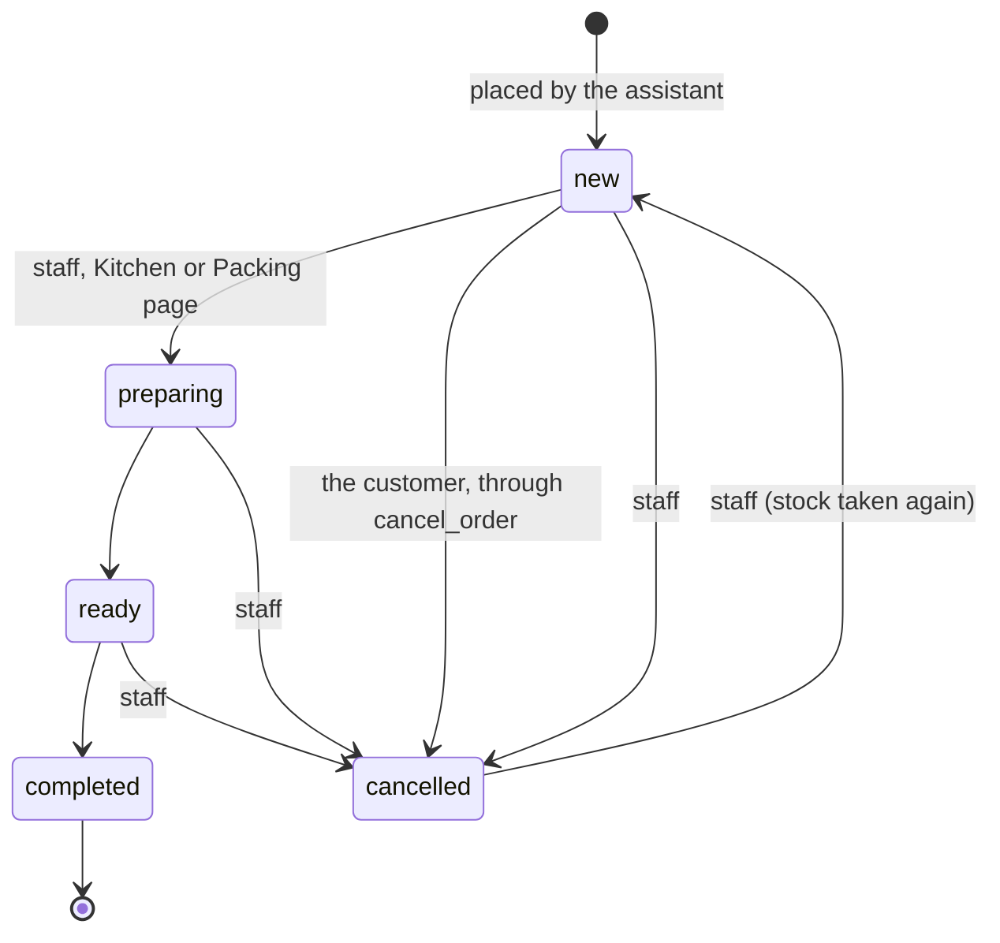

Each time staff move an order, `main.set_order_status` sends the customer the matching message from the business file: `order_<status>_<fulfilment>` if there is one (for example `order_ready_delivery`, "on its way"), otherwise `order_<status>`. A customer can only cancel through the assistant while the order is still `new`; after that it's a person's call.

### The 24-hour window

Meta only allows free-form messages to a customer within 24 hours of their last message (SMS has no such rule); after that it needs a template, which isn't built yet (issue #11).

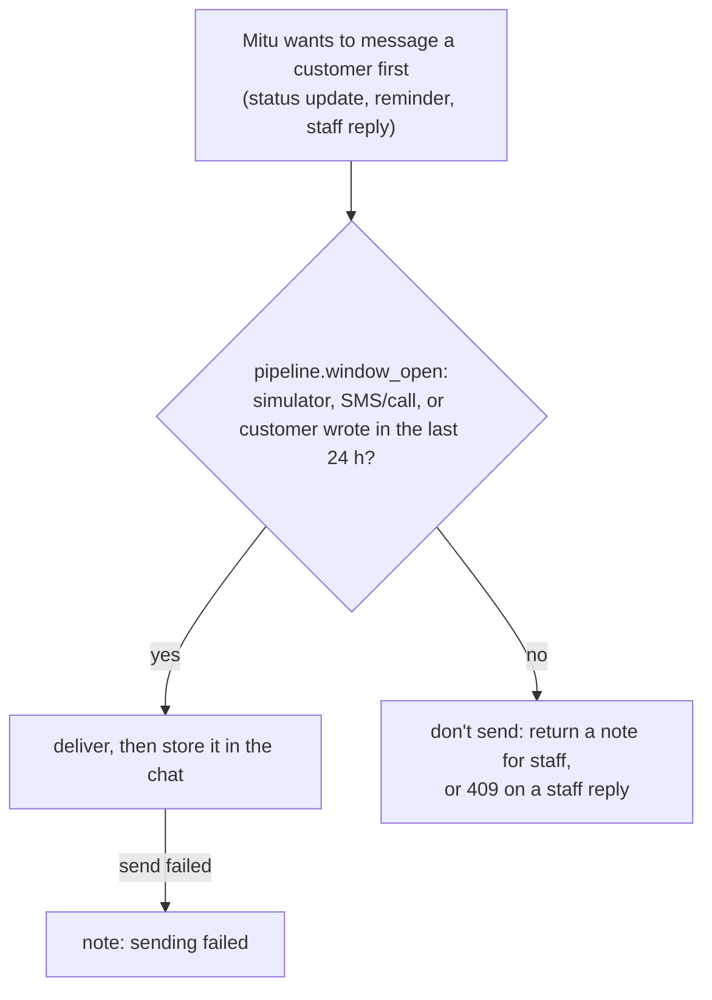

Replies to a customer's message never hit this, since the customer just wrote. Everything Mitu starts goes through `pipeline.send_update`, which returns why a message wasn't sent so the dashboard can show it.

### The reminder for an unanswered order summary

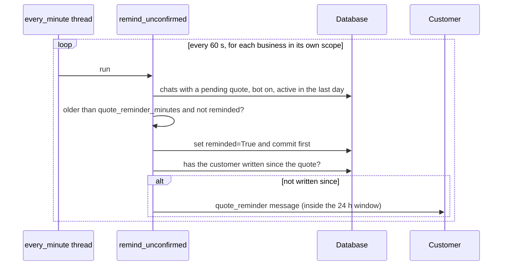

It's marked before sending, so a send that fails or a crash halfway never turns into a second nudge.

### Voice notes

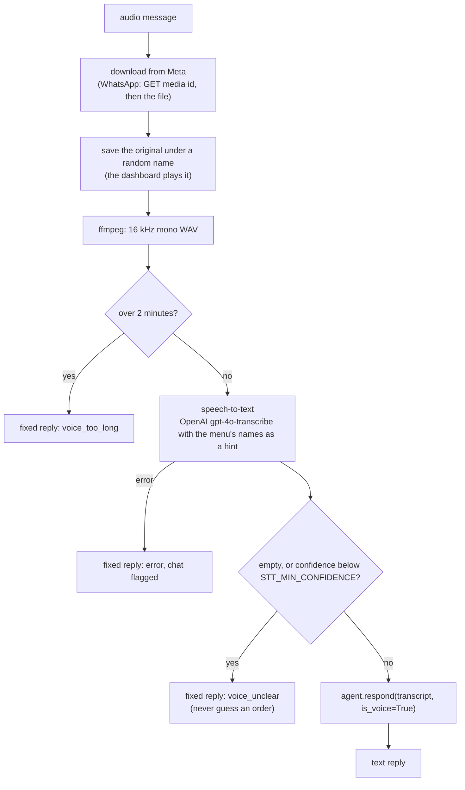

The fixed replies skip the LLM and come from `messages` in the business file. Each step's time is logged per voice note. See [Voice notes](#voice-notes) for the settings.

### Photos, in and out

**In:** a customer sends a photo, often a screenshot of one of the shop's posts.

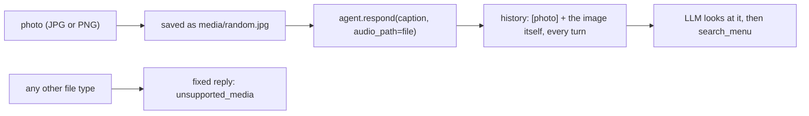

**Out:** the model calls `send_item_photo(item_id)` for items with a photo (uploaded on the Menu page, stored under `media/menu/<business>/<item id>.jpg`). `pipeline.deliver` sends it: on WhatsApp it uploads the file and sends it with the name and price as a caption, on Messenger and Instagram Meta fetches it from `PUBLIC_URL`. The photo is stored in the chat as a `[photo sent]` message so the model knows it's already there.

### Handing a chat to a person

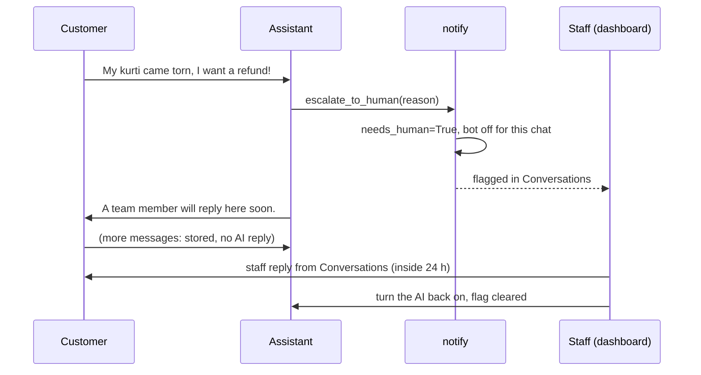

Other ways a chat gets flagged: the LLM call fails (the customer gets `messages.error`), or a voice note can't be processed. Those flag the chat but leave the AI on. A flagged chat shows in Conversations with its reason, and doesn't count as AI-handled on the Overview.

### Signing in

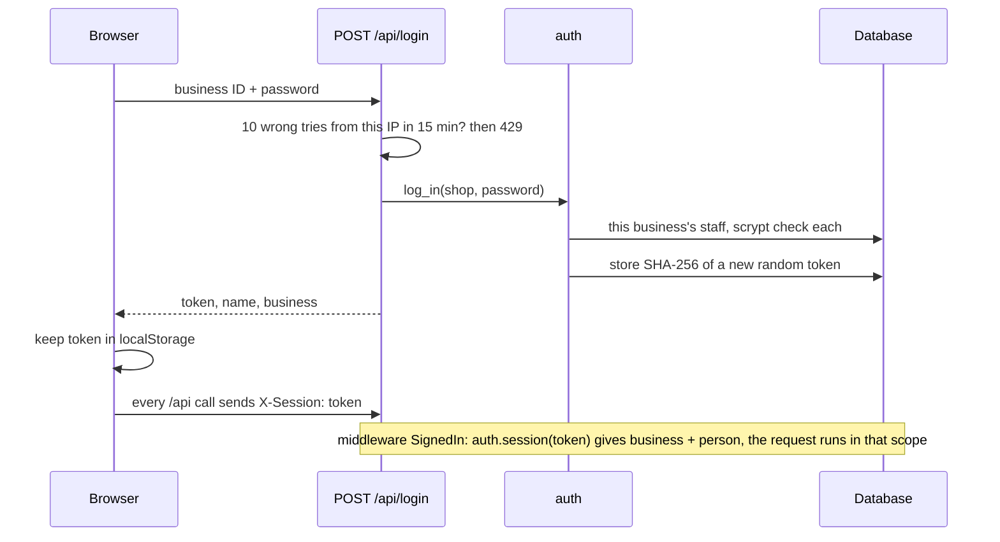

The password says who you are, so there are no usernames: each person at a business has their own password. Sessions last 30 days, and a 401 anywhere logs the dashboard out. The lockout is per IP, so a guesser can't lock the owner out.

### Live updates in the dashboard

The dashboard polls instead of using websockets. `useLive(path, ms)` in [`App.jsx`](frontend/src/App.jsx) fetches a path every `ms`, keeps the last answer per path (so going back to a page shows it instantly), and pauses while the tab is hidden.

| Page | Polls | Every |
|---|---|---|
| Conversations | chat list, open chat's messages | 2 s |
| Kitchen / Packing | active orders (plays a sound on a new one) | 3 s |
| Orders | all orders | 5 s |
| Sidebar badge | conversations | 5 s |
| Menu, Overview, orders-paused switch | menu, analytics, settings | 15 s |
| Simulator | the simulated chat | 1 s |

Browsers slow down timers in background tabs, so the kitchen screen should stay in front for the sound.

### The simulator

The simulator is a WhatsApp-style phone in the browser that runs the **same path as a real message**, which is why it needs a signed-in user (every message runs the paid LLM and can place real orders):

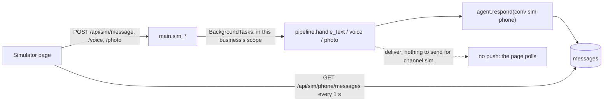

Simulator chats have ids `<business>:sim-<phone>` and show up in Conversations like any other chat. The 24-hour window is always open for them. `cli.py` does the same from a terminal.

### Where the Overview numbers come from

`GET /api/analytics?days=N` in [`main.py`](backend/app/main.py) computes the period and the one before it (same length) with `_period`:

| Figure | How it's counted |
|---|---|
| Revenue, orders, average order | orders created in the period that aren't cancelled (totals in cents) |
| Cancelled | orders created in the period that are |
| Chats | conversations with a customer message in the period |
| Conversion | chats that placed an order, out of all chats |
| AI handled | chats never flagged and with no staff reply, out of all chats |
| AI cost, tokens | `llm_usage` rows in the period (one per API call) |
| Revenue per day, top items, pickup vs delivery, statuses | from the same orders |

"Today" and day boundaries are in the business's timezone. It's computed in Python over the period's rows, which is fine for a small shop; the `ponytail:` comment there says when to move it to SQL.

### Data model

```mermaid
erDiagram
    SHOP ||--o{ STAFF : employs
    STAFF ||--o{ LOGIN_SESSION : "signs in with"
    SHOP ||--o{ MENU_ITEM : sells
    SHOP ||--o{ CONVERSATION : has
    CONVERSATION ||--o{ MESSAGE : contains
    MESSAGE ||--o{ TOOL_CALL : "answered with"
    CONVERSATION ||--o{ LLM_USAGE : costs
    CONVERSATION ||--o{ ORDER : "placed in"
    SHOP ||--o{ SETTING : has
    SHOP {
        string id PK "slug staff type to sign in"
        json config "business.yaml without the menu"
        string whatsapp_phone_number_id
        string page_id
        string instagram_id
    }
    MENU_ITEM {
        string id "the business's own code, e.g. M01"
        int price "cents"
        json options
        bool available "sold-out switch"
        int stock "null = not counted"
    }
    CONVERSATION {
        string id PK "business:phone"
        string channel "whatsapp messenger instagram sim"
        bool bot_enabled
        bool needs_human
        json pending_order "the last quote"
    }
    MESSAGE {
        int id PK
        string role "user assistant human"
        string text
        string audio_path "voice note or photo"
    }
    ORDER {
        int id PK
        json items "name and unit price at the time"
        int total "cents"
        string status
        datetime ready_at "UTC"
    }
```

Every table except `shops`, `staff`, `login_sessions` and `seen_wa_messages` is `Scoped` (it has a `shop_id` and is filtered by tenancy). Times are stored as naive UTC and shown in the business's timezone; money is integer cents. An order keeps each line's name and price, so editing or deleting a menu item never changes past orders. New columns are added on startup by `db.init_db` (add-only; renames and drops need a real migration tool).

### From a business file to features

```mermaid
flowchart LR
    F["business.yaml"] --> SH["shops.create / manage.py add-shop"]
    SH --> C["shops.config (everything but the menu)"]
    SH --> MI["menu_items (the menu)"]
    C --> T["tools.enabled() and specs()"]
    C --> P["agent.system_prompt()"]
    C --> PG["GET /api/business: which pages show,<br/>and their labels (Products, Packing)"]
    C --> MSG["fixed replies and customer updates (messages)"]
    C --> H["hours.py: opening hours, timezone"]
```

After the first import, the menu is managed on the dashboard; re-running `seed.py` or `manage.py update-shop` only adds items that aren't there yet and replaces the settings. That's why the settings live as JSON on the shop row: one install can hold a shop and a café side by side.

### The components

```mermaid
flowchart TD
    MAIN["main.py<br/>dashboard API, simulator, background jobs"] --> PIPE
    WA["whatsapp.py"] --> PIPE
    MS["messenger.py"] --> PIPE
    PIPE["pipeline.py<br/>one entry per message type"] --> AG["agent.py<br/>prompt, history, turn"]
    PIPE --> VO["voice.py"]
    AG --> LLM["llm.py"]
    AG --> TO["tools.py"]
    TO --> HO["hours.py"] & OP["options.py"] & NO["notify.py"]
    TO & AG & MAIN --> DB["db.py"]
    DB --> TE["tenancy.py"]
    MAIN --> AU["auth.py"]
    SHOPS["shops.py<br/>(manage.py, seed.py)"] --> DB
```

The breakdowns below go from the middle out: the message path first, then the data layer, the edges and the tooling.

#### `pipeline.py`: one path for every message

[`backend/app/pipeline.py`](backend/app/pipeline.py)

- **Owns:** turning an incoming event into an agent turn and a sent reply. `handle_whatsapp_message` and `handle_meta_event` take a raw webhook payload, set the business scope, and call `handle_text`, `handle_voice` or `handle_photo`.
- **Sends:** `deliver(channel, phone, text, image)` is the only function that talks to a channel's Send API; `send_update` wraps it for messages Mitu starts, with the 24-hour check.
- **Fixed replies:** `canned_reply` stores the customer's message and answers from `messages` in the business file without the LLM (unsupported file types, unclear or long voice notes, errors).
- **Background work:** `remind_unconfirmed` (every minute) and `resume_unfinished` (at startup).
- **Change it when:** a new message type or a new channel arrives. Behaviour that every channel should share goes in here or in `agent.respond`, not in a channel module.

#### `agent.py`: the assistant's turn

[`backend/app/agent.py`](backend/app/agent.py)

- **Owns:** the system prompt (`system_prompt`), the history (`build_history`) and the turn itself (`respond`).
- **Keeps:** one turn at a time per chat (`_locks`), the customer's message stored before anything can fail, the bot-off switch respected (staff are handling the chat), every tool call and API call recorded.
- **On failure:** the chat is flagged for a person and the customer gets the business's `messages.error`, never a stack trace or silence.
- **Change it when:** the assistant's behaviour or wording changes. Prompt changes need an eval run (`python eval.py`), since the fake LLM in the tests can't tell whether the real model behaves.

#### `tools.py`: what the assistant can do

[`backend/app/tools.py`](backend/app/tools.py)

- **Owns:** every action the LLM can take, as plain functions `fn(ctx, **args) -> dict`, plus the JSON schemas it sees (`specs`). `ctx` carries the database session, the conversation and the id of the message being answered.
- **Groups:** menu (`search_menu`, `get_menu`, `get_item`, `send_item_photo`), orders (`saved_details`, `create_order`, `get_order_status`, `cancel_order`), and the business (`get_business_info`, `escalate_to_human`).
- **Rules it enforces:** prices and totals in cents from the database, stock and sold-out, required options, opening hours and lead time, delivery address, payment method, the two-step order, one chat's own orders only.
- **Results talk to the model:** errors come back as `{"error", "problems"}` and successes carry a `status` like `PLACED` or `QUOTE_ONLY_NOT_PLACED` and often an `instruction`, which is how the code steers what the model says next.
- **Change it when:** the assistant needs a new ability. Add the function, its entry in `FUNCTIONS` and its schema, decide in `enabled()` which businesses get it, write a test, then run the eval.

#### `llm.py`: one interface over two providers

[`backend/app/llm.py`](backend/app/llm.py)

- **Interface:** `run(system, history, tools, call_tool, usage) -> reply text`. That's all the rest of the app knows about LLMs.
- **Providers:** `OllamaLLM` (local, the default, free) and `AnthropicLLM` (prompt caching, low effort for short replies, server-side refusal fallback). `LLM_PROVIDER` picks one; `get_llm()` builds it once.
- **Usage:** each API call appends tokens (including cache reads and writes) to `usage`; `cost_usd` prices it from `PRICES`, so the Overview shows the real cost per business. Ollama costs 0; an unknown model costs `None` rather than a guess.
- **Images:** customer photos go to each provider in its own format.
- **Change it when:** adding a provider or a model's price. Tests swap the whole thing for `FakeLLM` (see Testing).

#### `tenancy.py` and `db.Scoped`: one business per query

[`backend/app/tenancy.py`](backend/app/tenancy.py), [`backend/app/db.py`](backend/app/db.py)

- **Scope:** `tenancy.scope(shop, staff)` is a context manager over two `ContextVar`s. `shop()`, `shop_id()`, `cfg()` (the business's settings) and `staff()` read them; `shop()` raises when nothing is in scope.
- **Filter:** every business-owned model subclasses `db.Scoped`. A SQLAlchemy `do_orm_execute` hook (`_only_this_cafe`) adds `shop_id = <in scope>` to every SELECT, UPDATE and DELETE that touches one, including joins and aliases. New rows get `shop_id` by default.
- **Rule:** never add a manual `shop_id` filter as a workaround, and never query a `Scoped` table outside a scope. A new business table subclasses `Scoped` and gets a test in `tests/test_tenancy.py` proving one business can't see another's rows.
- **Why it's built this way:** a forgotten `WHERE` can't leak another shop's orders, because there's no `WHERE` to forget.

#### `db.py`: models and the database

[`backend/app/db.py`](backend/app/db.py)

- **Platform tables (not scoped):** `Shop` (settings and channel ids/tokens), `Staff`, `LoginSession`, `SeenWhatsAppMessage` (the webhook inbox).
- **Business tables (scoped):** `MenuItem`, `Conversation`, `Message`, `Order`, `Setting`, `ToolCall`, `LlmUsage`. See the [data model](#data-model).
- **Conventions:** money in integer cents, times in naive UTC (`db.now()`), order statuses in `ORDER_STATUSES`. SQLite by default (`DATABASE_URL`), with a 30-second lock timeout for concurrent writers.
- **Migrations:** `init_db()` creates tables and adds missing columns; it refuses a database from the old single-business version instead of guessing.
- **Change it when:** a new field or table. Nullable new columns arrive on their own; anything else needs a migration plan.

#### `whatsapp.py`: the WhatsApp Cloud API

[`backend/app/whatsapp.py`](backend/app/whatsapp.py)

- **Webhook:** `GET /webhook` answers Meta's verification; `POST /webhook` checks the signature, finds the business by `phone_number_id`, records each message once and queues it.
- **Graph API client:** `send_text`, `send_image`, `upload_media`, `download_media`, `mark_read`, each with the token and number of the business in scope.
- **Shared helpers** used by Messenger too: `valid_signature`, `shop_for`, `first_time_seen`, and the `http` client that tests replace with a mock transport.
- **Change it when:** Meta changes its API (`GRAPH_API_VERSION`) or a new WhatsApp message type is supported (then also `pipeline.handle_whatsapp_message`).

#### `messenger.py`: Facebook Messenger and Instagram

[`backend/app/messenger.py`](backend/app/messenger.py)

- **Webhook:** `GET` and `POST /messenger/webhook`, verified and signed with the same Meta app as WhatsApp. `CHANNELS` maps the webhook's `object` to `messenger` or `instagram`, and `ID_COLUMN` says which shop column the entry id matches.
- **Send API:** `send_text`, `send_image` (by public URL) and `download` for attachments, using the business's Page token.
- **Skips:** reads, deliveries and echoes of our own messages, so the assistant never answers itself.
- **Change it when:** comment replies arrive (issue #16) or staff replies from the Meta inbox should pause the AI (issue #27).

#### `voice.py`: speech-to-text

[`backend/app/voice.py`](backend/app/voice.py)

- **Speech-to-text:** `OpenAISTT.transcribe(wav) -> Transcript(text, language, confidence)`: gpt-4o-transcribe (or Whisper), prompted with the menu's item names via `stt_hint` and the business's `voice_language` if set, confidence from token (Whisper: segment) log-probabilities. `get_stt()` builds it, and tests swap it for a fake.
- **ffmpeg helpers:** `to_wav` (16 kHz mono for speech-to-text) and `wav_seconds`. Temp files rather than pipes, because browser recordings need seekable input.
- **Change it when:** adding a speech provider (make `get_stt()` pick one) or spoken replies.

#### `auth.py`: passwords and sessions

[`backend/app/auth.py`](backend/app/auth.py)

- **Passwords:** scrypt with a random salt; the cost is stored with each hash, so raising `SCRYPT_N` later doesn't break old passwords. `strong_enough` rejects passwords under 8 characters and common ones like `admin`.
- **Sessions:** `log_in` returns a random token and stores only its SHA-256, so a leaked database hands out no live sessions. `session(token)` gives back the business and the person, for 30 days. `log_out` deletes it.
- **Why tokens:** checking a slow scrypt hash on every 2-second poll would be too slow, so the token stands in for the password.
- **Change it when:** adding roles (everyone at a business can do everything today) or session expiry on password change.

#### `main.py`: the dashboard API

[`backend/app/main.py`](backend/app/main.py) creates the FastAPI app, the `SignedIn` middleware (session → scope), the background threads, and these routes. All `/api` routes except login need a session.

| Area | Routes |
|---|---|
| Signing in | `POST /api/login`, `POST /api/logout`, `GET /api/me`, `GET /api/business` (name, currency, which pages apply) |
| Simulator | `POST /api/sim/message`, `/voice`, `/photo`, `GET /api/sim/{phone}/messages` |
| Conversations | `GET /api/conversations`, `GET .../{id}/messages` (with "AI used" and cost), `GET /api/messages/{id}/steps`, `POST .../{id}/reply`, `POST .../{id}/bot`, `GET /api/saved-replies` |
| Orders | `GET /api/orders` (`?active=true` for the kitchen), `GET /api/orders/export.csv`, `PATCH /api/orders/{id}` (status, tells the customer) |
| Settings | `GET` and `PUT /api/settings` (`orders_paused`) |
| Menu | `GET` and `POST /api/menu`, `PATCH` and `DELETE /api/menu/{id}`, `POST /api/menu/{id}/photo` |
| Overview | `GET /api/analytics?days=30` |

Webhooks come from the `whatsapp` and `messenger` routers, and `/media` is served as static files. The CSV export guards against formula injection: a cell starting with `=`, `+`, `-` or `@` gets a leading `'`.

#### `hours.py`: time in the business's timezone

[`backend/app/hours.py`](backend/app/hours.py)

- **Now:** `local_now()` is the business's wall-clock time (from `timezone` in its settings). Use it, never `datetime.now()`; the tests pin it to 10:00.
- **Converting:** `to_utc` and `to_local` between the naive UTC in the database and naive local times in the business's zone.
- **Opening hours:** `periods(day)` parses `"07:00-15:00"` or `"07:00-11:00, 17:00-21:00"` (or `closed`), `is_open(at)`, `spec(day)` and `weekly()`.
- **Showing it:** `label(at)` gives `"Sat 12 Oct, 13:30"`, with the weekday spelled out so nobody has to work it out.

#### `options.py`: item options

[`backend/app/options.py`](backend/app/options.py)

One line per option group, the same in the business file and the dashboard:

| Line | Means |
|---|---|
| `Size*: Regular, Large +0.80` | pick exactly one; `*` makes it required; `+0.80` is the extra cost |
| `Milk: Full cream, Oat +0.80` | pick at most one |
| `Extras (any): Extra shot +0.60` | pick any number |

`parse` turns lines into stored groups (and raises naming the wrong line), `lines` turns them back for editing, `describe` writes them for the model, and `choose` checks a customer's picks and adds up the extra cost. A missing required choice comes back to the model as a problem, so it asks instead of guessing.

#### `notify.py`: telling the team

[`backend/app/notify.py`](backend/app/notify.py)

- `flag_for_human(db, conv, reason, stop_bot)` sets `needs_human` and the reason, and optionally turns the AI off for that chat. Staff see it in Conversations.
- **Change it when:** alerts should reach the owner outside the dashboard (email, WhatsApp, a push notification). This is the one place to add it.

#### `config.py`: settings and money

[`backend/app/config.py`](backend/app/config.py)

- Loads `.env` from the repository root and exposes the install-wide settings: `DATABASE_URL`, `MEDIA_DIR`, `LLM_PROVIDER`, the Meta app's secret and verify token, `PUBLIC_URL`, speech settings, and the first business's `SHOP_ID`, `ADMIN_PASSWORD`, `STAFF` and channel tokens (used only by `seed.py`).
- **Money:** `cents(4.50) -> 450` on the way in, `money(450) -> "৳4.50"` on the way out, with the currency of the business in scope. Amounts are never floats in the database.
- Per-business settings are not here: they're the business file, read through `tenancy.cfg()`.
- New env vars go in `.env.example` too, with a comment.

#### `shops.py`, `manage.py` and `seed.py`: setting businesses up

- [`shops.py`](backend/app/shops.py): `create(db, id, business, staff, **channels)` makes a business from a parsed business file, with its staff and menu; `add_new_menu_items` adds only items the database doesn't have; `pick` finds a business for command-line tools.
- [`manage.py`](backend/manage.py): `list`, `add-shop <id> <file> --owner-password`, `update-shop <id> <file>`, `add-staff <id> <name> <password>`, `connect <id> --whatsapp-number-id ... --page-id ...`. Passwords are checked with `auth.strong_enough`.
- [`seed.py`](backend/seed.py): creates the first business from `.env` and `BUSINESS_FILE` if the database has none, with a few sample orders. `--if-empty` is what Docker runs at start; `--demo` adds about 60 days of random history to fill the Overview; sample customers fit the business's timezone (Dhaka names and `017` numbers for the shop).

#### The frontend

[`frontend/src`](frontend/src): React, Vite and Tailwind, with no router or state library.

| File | What's in it |
|---|---|
| [`App.jsx`](frontend/src/App.jsx) | `api()` (adds `X-Session`, logs out on 401), `usePoll` and `useLive`, toasts, the login page, the shell with the sidebar, and hash routing (`#/orders`, `#/simulator`) |
| [`Dashboard.jsx`](frontend/src/Dashboard.jsx) | the pages: Conversations (with "AI used" steps), Orders, Packing/Kitchen, Products/Menu with its item form |
| [`Analytics.jsx`](frontend/src/Analytics.jsx) | the Overview: figures with change against the previous period, the revenue chart, top items |
| [`Simulator.jsx`](frontend/src/Simulator.jsx) | the phone: text, hold-to-record voice, photos |
| [`ui.jsx`](frontend/src/ui.jsx) | shared pieces: icons, buttons, `Segmented`, `Drawer`, money formatting |

Which pages show and what they're called comes from `GET /api/business` (a business without orders has no Packing or Orders page, and the café calls Products "Menu"). In development Vite proxies `/api` and `/media` to the backend; in Docker, Caddy does. CI only builds it (`npm run build`).

#### Docker and Caddy

- **Backend image** ([`backend/Dockerfile`](backend/Dockerfile)): Python 3.12 slim with ffmpeg; starts with `seed.py --if-empty`, then uvicorn on port 8000 behind the proxy.
- **Frontend image** ([`frontend/Dockerfile`](frontend/Dockerfile)): builds the React app, then serves it with Caddy. [`Caddyfile`](frontend/Caddyfile) sends `/api/*`, `/media/*`, `/webhook` and `/messenger/webhook` to the backend and everything else to `index.html` (so hash routes work on refresh).
- **HTTPS:** set `SITE_ADDRESS` to a domain and Caddy gets and renews the certificate; the `caddy` volume keeps it across restarts (Let's Encrypt rate-limits re-issuing).

#### `backup.py`: backups

[`backend/backup.py`](backend/backup.py) writes one `.tar.gz` with a consistent copy of the SQLite database (SQLite's own backup API, safe while the app is writing) and the media folder, and keeps the newest `BACKUP_KEEP` (14). The `backup` container runs it at start and then daily into `./backups`.

A backup on the same disk doesn't survive losing the server: copy the folder off the server too. To restore, stop the stack, put `shop.db` and `media/` back into the `data` volume, and start it again.

### Testing

`pytest` runs in about 15 seconds with no credentials, because everything outside the process is faked in [`tests/conftest.py`](backend/tests/conftest.py):

| Real thing | In the tests |
|---|---|
| The database | a fresh SQLite file per test, with the café `little-fern` from `examples/cafe.yaml` in scope |
| The LLM | `FakeLLM`: each queued turn is a function `(history, call_tool) -> reply`, so a test decides which tools the "model" calls |
| Meta's Graph API | the `graph` fixture: an httpx mock transport that records every request |
| The clock | `hours.local_now` pinned to 10:00 today, so opening-hour rules don't depend on when tests run |
| Logins | each staff member's session token is their password; scrypt runs at a tiny cost |
| Speech | a fake STT returning a set transcript, and ffmpeg stubbed |

| File | Covers |
|---|---|
| `test_agent.py` | the tools, ordering rules and the confirmation guard |
| `test_webhook.py` | signatures, routing to the right business, dedupe, resume, every channel |
| `test_tenancy.py` | one business can never see or change another's data, through any page or webhook |
| `test_dashboard.py`, `test_analytics.py` | the API the dashboard uses, and the order reminder |
| `test_business_types.py` | the shop: stock, orders for later days, its words on the dashboard |
| `test_voice.py`, `test_backup.py`, `test_eval.py` | voice notes, backups, the eval's own checks |

A bug fix or new rule starts with a failing test in the matching file.

### The eval

The tests can't tell whether the real model behaves; [`eval.py`](backend/eval.py) can. It runs the scripted conversations in [`evals/cases.yaml`](backend/evals/cases.yaml) against the LLM in `.env`:

```mermaid
flowchart TD
    Y["cases.yaml"] --> F["pick cases by word (optional)"]
    F --> D["for each case: a fresh throwaway database<br/>with its business file (cafe by default, or the shop)<br/>plus setup_order"]
    D --> K["clock set to 10:00 business time"]
    K --> T["for each turn: agent.respond(say) with the real model,<br/>every tool call recorded"]
    T --> C1["turn checks: calls, no_calls, reply regex, no_reply,<br/>order count"]
    C1 --> C2["end checks: called, called_any, needs_human,<br/>fields of order 1"]
    C2 --> R["pass or fail, transcript of failures, cost in $"]
    R --> X["exit 1 if any case failed"]
```

It costs real money (roughly $1–3 for a full run on Sonnet, free on Ollama), so run it after changing the prompt, the tools or the model, not on every change. When a real chat goes wrong, add it as a case.

### CI/CD

```mermaid
flowchart LR
    E["push or pull request"] --> B["Backend: ruff check, pytest"]
    E --> FE["Frontend: npm ci, npm run build"]
    B & FE --> M{"push to main?"}
    M -- "no (pull request)" --> DONE["checks shown on the PR"]
    M -- "yes" --> I["build backend and frontend images<br/>push to ghcr.io, tagged latest and the commit SHA"]
    I --> H{"DEPLOY_HOST secret set?"}
    H -- "no" --> SK["deploy skipped with a notice"]
    H -- "yes" --> SSH["over SSH: copy docker-compose.yml, business.yaml and .env,<br/>docker compose pull and up -d"]
```

[`.github/workflows/ci-cd.yml`](.github/workflows/ci-cd.yml) needs no secrets for the checks. [`claude.yml`](.github/workflows/claude.yml) is separate: it starts an agent on an issue when it gets the `claude` label or an `@claude` mention.

### Where to change what

| You want to… | Change | And |
|---|---|---|
| Change what the assistant says or how it behaves | `agent.system_prompt` | run the eval |
| Give the assistant a new ability | a function, schema and `FUNCTIONS` entry in `tools.py`; `enabled()` for who gets it | a test in `test_agent.py`, then the eval |
| Add a rule the model must not break | the tool that does it (like `create_order`), not only the prompt | a failing test first |
| Add a setting to the business file | read it with `tenancy.cfg()` where it's used | document it in [Set up a business](#3-set-up-a-business) |
| Add a business table | a model subclassing `db.Scoped` | a test in `test_tenancy.py` |
| Support a new message type | `pipeline.py` (and the channel's webhook parser) | a test in `test_webhook.py` |
| Add a channel | a router like `messenger.py` or `twilio.py`, a branch in `pipeline.deliver` | route it through `pipeline`, never straight to the agent |
| Add an LLM provider | a class in `llm.py` with `run(...)`, its prices in `PRICES` | `LLM_PROVIDER` in `.env.example` and the README |
| Add a dashboard page | an endpoint in `main.py`, a page in `Dashboard.jsx`, a link in `App.jsx` | `npm run build` |
| Add an env var | `config.py` | `.env.example` and the README |
| Fix a chat that went wrong | the tool or prompt, whichever caused it | a case in `evals/cases.yaml` |
